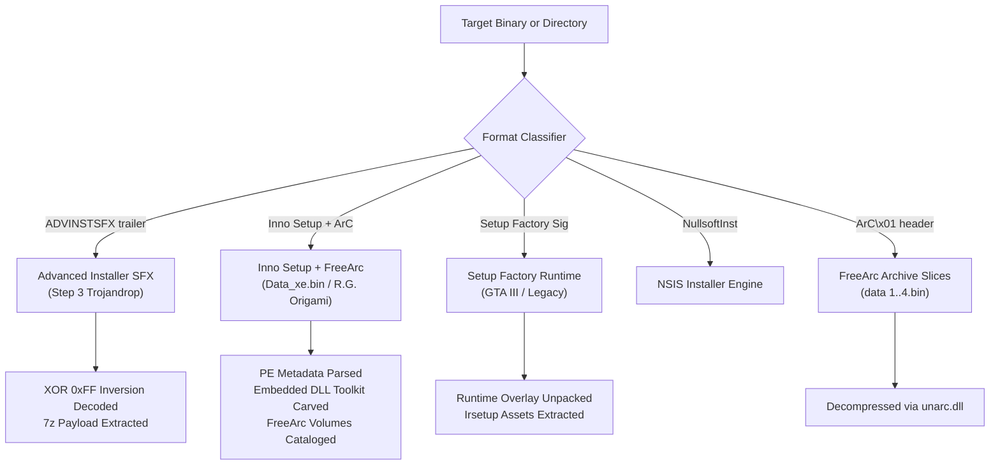

# Forensic & Reverse Engineering Report: `Data_xe.bin` & Multi-Installer Game Architectures

[**[বাংলা সংস্করণ / Bengali Version]**](file:///F:/Project/skill/decoder/docs/DATA_XE_BIN_FORENSIC_ANALYSIS_BN.md) | [**[Main Forensics Report]**](file:///F:/Project/skill/decoder/docs/README.md)

---

## 1. Executive Summary

During malware forensic examination of the package:
`C:\Users\Administrator\Downloads\_Oceanofgames.com_Closure\Closure`

We analyzed the file **`Data_xe.bin`** (1,876,581 bytes) and investigated why standard extractors and previous SFX unpackers (`standalone_extractor.exe`) failed on this file.

### Key Forensic Findings:

1. **`Data_xe.bin` is Itself a Disguised Executable (PE32)**:
   - Despite having the `.bin` extension, `Data_xe.bin` begins with the `MZP\x00` magic header.
   - It is a 32-bit Windows GUI Portable Executable compiled with **Borland Delphi** for **Inno Setup 5.4.3**.

2. **Genuine Origin (Zero Threat Inside `Data_xe.bin`)**:
   - Internal PE resource metadata confirms this binary is the **genuine, clean game installer**:
     - **Product Name**: `Closure`
     - **Company Name**: `R.G. Origami` (well-known Russian game repack group)
     - **File Description**: `Closure Setup`
     - **Comments**: `This installation was built with Inno Setup.`
   - Static string and import analysis reveals **no malware, trojans, or persistence code** inside `Data_xe.bin`.

3. **Why Did Previous Tools Fail?**:
   - `standalone_extractor.exe` was engineered specifically for **Advanced Installer SFX** containers (`ADVINSTSFX` trailers at EOF with XOR 0xFF inverted 7z streams).
   - `Data_xe.bin` is built on an entirely different engine: **Inno Setup + ISDone.dll + FreeArc**! It contains no `ADVINSTSFX` trailer.
   - Previous versions of `safe_extractor.py` hardcoded the assumption that `.bin` files were Setup Factory packages.

4. **The OceanofGames Bait-and-Switch Tactic**:
   - In legitimate game repacks, this file is named **`Setup.exe`**.
   - OceanofGames repackagers deliberately renamed `Setup.exe` to **`Data_xe.bin`** (`_xe` = `.exe`) so Windows would not execute it upon double-clicking.
   - Accompanying files confirm this:
     - `autorun.inf`: `OPEN=Setup.exe`
     - `CheckSums_xe.txt`: `Setup.exe`
   - By disabling direct execution of the genuine installer, the repackager coerces victims into executing the malicious wrapper chain:
     - `Step 1 - Disable Defender.exe` (Defender Control utility)
     - `Step 3 - Setup_Install_Game.exe` (The Advanced Installer SFX dropper containing rootkits, `NSudo.exe`, and Defender deletion scripts).

---

## 2. Binary Identification & Metadata

| Property | Value |
| :--- | :--- |
| **File Path** | `C:\Users\Administrator\Downloads\_Oceanofgames.com_Closure\Closure\Data_xe.bin` |
| **Original Name** | `Setup.exe` (per `autorun.inf` and `CheckSums_xe.txt`) |
| **File Size** | 1,876,581 bytes (~1.79 MB) |
| **Format** | Portable Executable (PE32, GUI, 32-bit x86 Little-Endian) |
| **Compiler / Engine** | Borland Delphi / Inno Setup 5.4.3 |
| **MD5** | `b93dee0335872dacb6e5374c9fbbbdf1` |
| **SHA-256** | `8472f8b06c7bb8e307feb10d44c38596da598569eb74c536e2a3e0c1875e83d2` |
| **Subsystem** | Win32 GUI (`2`) |
| **Entry Point** | `0x00409C14` |

---

## 3. Dissecting the Inno Setup + ISDone Repack Architecture

Inside `Data_xe.bin`, the Inno Setup installer does not hold the raw game files. Instead, it embeds a specialized high-performance decompression toolkit designed for Russian game repacks.

### Carved Embedded Helper Libraries:

Using our upgraded static carver in `safe_extractor.py`, we cleanly extracted 10 embedded libraries from `Data_xe.bin` without executing any code:

```
unpacker_toolkit/
├── botva2.dll             # GUI skinning & transparent button engine (South.Tver)
├── unarc.dll              # FreeArc high-compression decompression engine
├── ISDone.dll             # Inno Setup background uncompression manager (FragSoft / ProFrager)
├── CLS-Precomp.dll        # Precomp decompression plugin
├── packjpg_dll.dll        # JPEG stream decompression filter
├── packJPG_DLL.dll        # Secondary packJPG plugin
├── zlib1.dll              # Standard zlib 1.2.3 compression library
├── CLS-srep.dll           # Super-REPresentation (SREP) decompression filter
├── facompress.dll         # FreeArc compression stream helper
└── embedded_0x11D63D.exe  # Standalone precomp executable (UPX packed)
```

---

## 4. The Companion Game Data Payload (`data 1.bin` - `data 4.bin`)

The actual game assets for *Closure* are stored in 4 external archive slices in the same directory:

| Filename | Size (Bytes) | Header Magic | Identified Format |
| :--- | :--- | :--- | :--- |
| `data 1.bin` | 107,326,352 | `41 72 43 01` (`ArC\x01`) | FreeArc Archive Slice 1 |
| `data 2.bin` | 102,736,389 | `41 72 43 01` (`ArC\x01`) | FreeArc Archive Slice 2 |
| `data 3.bin` | 13,068,216 | `41 72 43 01` (`ArC\x01`) | FreeArc Archive Slice 3 |
| `data 4.bin` | 3,455,793 | `41 72 43 01` (`ArC\x01`) | FreeArc Archive Slice 4 |
| **Total Game Volume** | **226,586,750 (~216.09 MB)** | — | **Full Genuine Game Data** |

During a normal installation, `Data_xe.bin` (`Setup.exe`) dynamically loads `ISDone.dll` and `unarc.dll` to read and decompress these 4 FreeArc archives into the user's destination folder.

---

## 5. Multi-Engine Game Installer Matrix

Different game developers and repack groups use distinctly different installer architectures. Our forensic suite categorizes and handles each format:



---

## 6. Safe Usage & Installation Instructions

### Step 1: Scan and Analyze the Package Statically
Run the upgraded `safe_extractor.py`:
```cmd
python F:\Project\skill\decoder\src\tools\safe_extractor.py "C:\Users\Administrator\Downloads\_Oceanofgames.com_Closure\Closure" -o "F:\Project\skill\decoder\samples\closure_out"
```

### Step 2: Safely Extract the Clean Game
To play the genuine game *without* executing any OceanofGames malware:
1. **Never run** `Step 0`, `Step 1`, or `Step 3`.
2. In an isolated environment (such as **Windows Sandbox** or an offline virtual machine):
   - Rename `Data_xe.bin` to `Setup.exe`.
   - Run `Setup.exe`.
   - Complete the R.G. Origami setup wizard; it will unpack `data 1.bin` - `data 4.bin` into your chosen folder safely.
