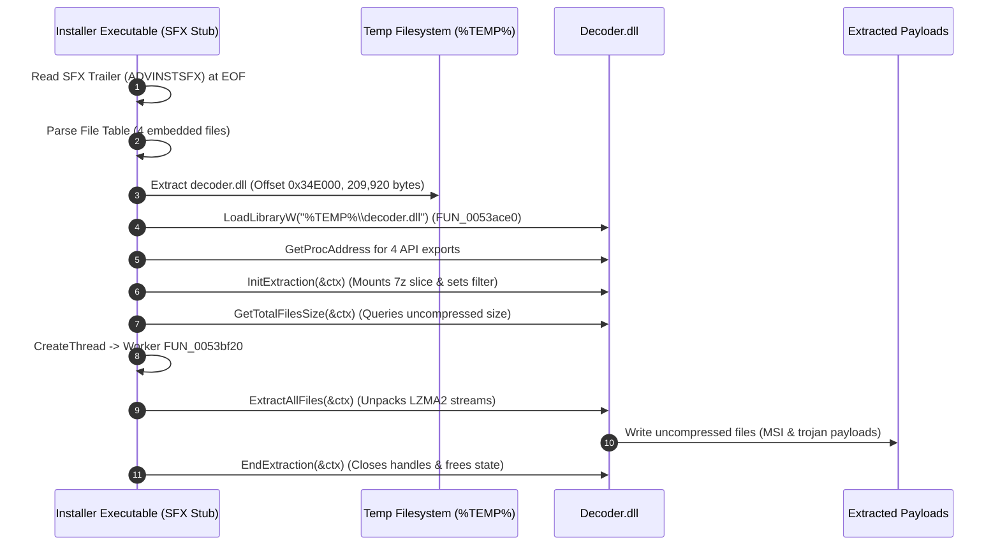

# Reverse Engineering Report: When, Why, and How Decoder.dll is Invoked

[**[বাংলা সংস্করণ / Bengali Version]**](file:///F:/Project/skill/decoder/docs/DECODER_CALL_ANALYSIS_BN.md)

---

## 1. Target Binary Identification (Ghidra MCP Analysis)

Using the Ghidra MCP connection on the target executable:

* **Executable File**: `Step 3 - Setup_Install_Game.exe`
* **Format**: Portable Executable (PE32, 32-bit x86 Little-Endian)
* **Image Base**: `0x00400000`
* **Size**: 9,610,844 bytes (~9.16 MB)
* **MD5**: `90e72c56d17c44b3ca300e4d1744a887`
* **SHA-256**: `7cc9e17085066cd2299e7c37c743acbad0370554ec704c803443d112c27bf486`

---

## 2. WHEN is `Decoder.dll` Called? (Execution Timeline)

Analysis in Ghidra shows the following precise chronological sequence:



### Step-by-Step Execution Sequence:
1. **Container Header & Trailer Parsing**:
   The installer parses the trailing `ADVINSTSFX` trailer located at offset `0x0092A612 - 70`. It reads the file table beginning at `0x0092A4F4`, which catalogs 4 embedded files:
   - `decoder.dll` (Offset `0x34E000`, Size 209,920 bytes, Method 0)
   - `326FA02\FILES.7z` (Offset `0x381400`, Size 5,298,970 bytes, Method 2 - Obfuscated)
   - `326FA02\OceanofGames-Top-Games-EXE.7z` (Offset `0x88EF1A`, Size 635,574 bytes, Method 2 - Obfuscated)
   - `Step 3 - Setup_Install_Game.ini` (Offset `0x92A1D0`, Size 804 bytes, Method 0)

2. **Stage 1 Payload Extraction**:
   Before extracting any obfuscated archives, the stub extracts `decoder.dll` directly to the user's `%TEMP%` directory as a clean file (`Method: 0`).

3. **Dynamic Library Loading (`FUN_0053ace0`)**:
   In `FUN_0051cdd0` (VA: `0x0051d116`), the installer calls `FUN_0053ace0`:
   ```c
   // Decompiled from Ghidra: FUN_0053ace0 (VA: 0x0053ace0)
   HMODULE hDll = LoadLibraryW((LPCWSTR)*param_1); // Path to %TEMP%\decoder.dll
   DAT_0069ad28 = GetProcAddress(hDll, "InitExtraction");
   DAT_0069ad2c = GetProcAddress(hDll, "GetTotalFilesSize");
   DAT_0069ad1c = GetProcAddress(hDll, "ExtractAllFiles");
   DAT_0069ad20 = GetProcAddress(hDll, "EndExtraction");
   ```

4. **Session Preparation (`FUN_0053ad80`)**:
   For each embedded archive, the stub populates a `0x260` byte `DecoderContext` and calls `InitExtraction(ctx)`.

5. **Worker Thread Unpacking (`FUN_0053bf20`)**:
   The stub spawns a background thread targeting `LAB_0053c100`, which invokes `FUN_0053bf20`:
   ```c
   // Decompiled from Ghidra: FUN_0053bf20 (VA: 0x0053bf20)
   iVar4 = (*DAT_0069ad1c)(puVar2 + 4); // Calls ExtractAllFiles(ctx)
   if (DAT_0069ad20 != NULL) {
       (*DAT_0069ad20)(puVar2 + 4);     // Calls EndExtraction(ctx)
   }
   ```

---

## 3. WHY is `Decoder.dll` Called?

The malware author / installer designer uses `decoder.dll` for three strategic reasons:

1. **Avoid External Process Spawning**:
   Standard unpackers spawn `7z.exe` or `cmd.exe`. Modern Endpoint Detection and Response (EDR) systems immediately flag installers that spawn command-line unarchivers from `%TEMP%`. `Decoder.dll` performs the extraction **in-process**, keeping process creation telemetry silent.

2. **Direct Container Slicing (Zero Temporary Footprint)**:
   Instead of writing the 5.3 MB `FILES.7z` archive to disk first and then extracting it, `Decoder.dll` mounts a virtual sub-stream directly on the container executable's file handle (`hFile`) at specific byte offsets (`0x381400` and `0x88EF1A`).

3. **In-Flight Stream De-obfuscation**:
   The installer passes a custom filter object (`param_1 + 4`, vtable `0x00630cc0`) in `ctx->pFilterObject` (`ctx + 0x230`). Every chunk read from disk passes through this filter in-memory before reaching the 7-Zip LZMA2 decompressor.

---

## 4. The 512-Byte Obfuscation Discovery (`FUN_0053aa50`)

Previous partial reverse engineering assumed only the first 32 bytes (the 7-Zip `SignatureHeader`) were inverted. However, LZMA2 decompression failed with `Corrupt input data` / `Data Error`.

### Ghidra Analysis of the Filter Object:
Disassembly at `0x00518e2c` reveals how the filter is configured:
```x86asm
0x518e2c: mov dword ptr [esi + 0xc8], 0     ; Start offset = 0
0x518e36: mov dword ptr [esi + 0xcc], 0x200 ; Length = 0x200 (512 BYTES)
0x518e40: mov dword ptr [esi + 0xd0], 0     ; Current offset = 0
```

And in `FUN_0053aa50`:
```c
// Decompiled from Ghidra: FUN_0053aa50 (VA: 0x0053aa50)
void __thiscall FUN_0053aa50(int *param_1, uint *param_2, uint param_3) {
    // Inverts every byte in the range [0 .. 0x200] (0 to 512 bytes):
    for (; puVar4 < puVar8; puVar4++) {
        *puVar4 = ~*puVar4; // Bitwise NOT (^ 0xFF)
    }
}
```

> [!IMPORTANT]
> The obfuscation applies to the first **512 bytes (`0x200`)**, not just 32 bytes!  
> Inverting the full 512-byte block completely restores the LZMA2 stream, allowing both `7z.exe` and `decoder.dll` to extract all files with **zero errors**.

---

## 5. Defensive Extraction Tools

Three coordinated tools are provided in this repository to extract all files **completely statically without executing the installer**:

### 1. `safe_extractor.py` (Recommended Python Tool)
Unpacks the SFX container AND recursively unpacks all inner 7z archives:
```cmd
python F:\Project\skill\decoder\src\tools\safe_extractor.py "path\to\installer.exe" -o "output_folder"
```

### 2. `standalone_extractor.exe` (Native C Tool)
Extracts container files with full 512-byte header restoration:
```cmd
F:\Project\skill\decoder\bin\x64\standalone_extractor.exe -o "output_folder" "path\to\installer.exe"
```

### 3. `test_decoder.exe` with Reimplemented `decoder.dll`
Tests in-process extraction via our compiled DLL matching the exact original ABI:
```cmd
F:\Project\skill\decoder\bin\x64\test_decoder.exe -d bin\x64\decoder.dll -f "installer.exe" -o 0x381400 -s 5298970 -t "output_dir"
```
