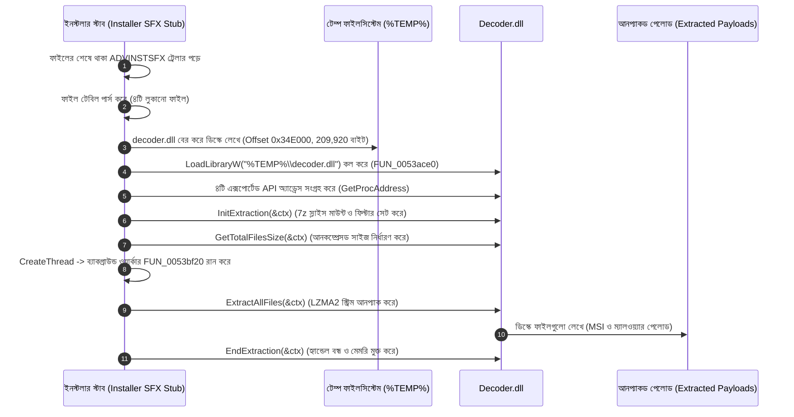

# রিভার্স ইঞ্জিনিয়ারিং রিপোর্ট: কখন, কেন এবং কীভাবে Decoder.dll কল করা হয়

[**[English Version / ইংরেজি সংস্করণ]**](file:///F:/Project/skill/decoder/docs/DECODER_CALL_ANALYSIS.md) | [**[মূল নির্দেশিকা / Main README]**](file:///F:/Project/skill/decoder/README.md)

---

## ১. টার্গেট বাইনারি পরিচিতি (Ghidra MCP অ্যানালাইসিস)

টার্গেট এক্সিকিউটেবলে Ghidra MCP সংযোগের মাধ্যমে প্রাপ্ত তথ্য:

* **টার্গেট ফাইল**: `Step 3 - Setup_Install_Game.exe`
* **ফরম্যাট**: Portable Executable (PE32, 32-bit x86 Little-Endian)
* **ইমেজ বেস (Image Base)**: `0x00400000`
* **ফাইলের আকার**: ৯,৬১০,৮৪৪ বাইট (~৯.১৬ মেগাবাইট)
* **MD5 হ্যাশ**: `90e72c56d17c44b3ca300e4d1744a887`
* **SHA-256 হ্যাশ**: `7cc9e17085066cd2299e7c37c743acbad0370554ec704c803443d112c27bf486`

---

## ২. কখন `Decoder.dll` কল করা হয়? (এক্সিকিউশন টাইমলাইন ও ফ্লো)

Ghidra-তে রিভার্স ইঞ্জিনিয়ারিং করে প্রাপ্ত এক্সিকিউশন সিকোয়েন্স নিচে তুলে ধরা হলো:



### বিস্তারিত ক্রমানুসারিক ধাপসমূহ:

1. **কন্টেইনার হেডার ও ট্রেলার পার্সিং**:
   ইনস্টলার এক্সিকিউটেবলটি চালু হলে প্রথমেই ফাইলের শেষপ্রান্তে অফসেট `0x0092A612 - 70`-এ থাকা `ADVINSTSFX` ট্রেলার পরীক্ষা করে। এরপর অফসেট `0x0092A4F4`-এ থাকা ফাইল টেবিল পার্স করে ৪টি লুকানো ফাইল শনাক্ত করে:
   - `decoder.dll` (অফসেট: `0x34E000`, আকার: ২০৯,৯২০ বাইট, মেথড: ০ - সাধারণ ফাইল)
   - `326FA02\FILES.7z` (অফসেট: `0x381400`, আকার: ৫,২৯৮,৯৭০ বাইট, মেথড: ২ - অবফাসকেটেড 7z)
   - `326FA02\OceanofGames-Top-Games-EXE.7z` (অফসেট: `0x88EF1A`, আকার: ৬৩৫,৫৭৪ বাইট, মেথড: ২ - অবফাসকেটেড 7z)
   - `Step 3 - Setup_Install_Game.ini` (অফসেট: `0x92A1D0`, আকার: ৮০৪ বাইট, মেথড: ০ - সাধারণ ফাইল)

2. **প্রথম ধাপ: ডিলএল ড্রপ (Stage 1 Payload Extraction)**:
   কোনো অবফাসকেটেড আর্কাইভ আনপ্যাক করার আগেই ইনস্টলার স্টাবটি সরাসরি `%TEMP%` ফোল্ডারে একটি পরিষ্কার ফাইল হিসেবে `decoder.dll` ড্রপ করে (`Method: 0`)।

3. **ডাইনামিক লাইব্রেরি লোডিং (`FUN_0053ace0`)**:
   ফাংশন `FUN_0051cdd0` (VA: `0x0051d116`)-এর ভেতর ইনস্টলার `FUN_0053ace0` কল করে:
   ```c
   // Ghidra ডিকম্পাইলেশন: FUN_0053ace0 (VA: 0x0053ace0)
   HMODULE hDll = LoadLibraryW((LPCWSTR)*param_1); // %TEMP%\decoder.dll পাথ
   DAT_0069ad28 = GetProcAddress(hDll, "InitExtraction");
   DAT_0069ad2c = GetProcAddress(hDll, "GetTotalFilesSize");
   DAT_0069ad1c = GetProcAddress(hDll, "ExtractAllFiles");
   DAT_0069ad20 = GetProcAddress(hDll, "EndExtraction");
   ```

4. **সেশন ইনিশিয়ালাইজেশন (`FUN_0053ad80`)**:
   প্রতিটি লুকানো 7z আর্কাইভের জন্য স্টাব একটি `0x260` বাইটের `DecoderContext` তৈরি করে `InitExtraction(ctx)` কল করে।

5. **ওয়ার্কার থ্রেডে এক্সট্রাকশন সম্পাদন (`FUN_0053bf20`)**:
   ইনস্টলার একটি ব্যাকগ্রাউন্ড থ্রেড তৈরি করে যার এন্ট্রি পয়েন্ট `LAB_0053c100`, যা `FUN_0053bf20` এক্সিকিউট করে:
   ```c
   // Ghidra ডিকম্পাইলেশন: FUN_0053bf20 (VA: 0x0053bf20)
   iVar4 = (*DAT_0069ad1c)(puVar2 + 4); // ExtractAllFiles(ctx) কল
   if (DAT_0069ad20 != NULL) {
       (*DAT_0069ad20)(puVar2 + 4);     // EndExtraction(ctx) কল
   }
   ```

---

## ৩. কেন `Decoder.dll` ব্যবহার করা হয়? (উদ্দেশ্য ও কৌশল)

ম্যালওয়্যার তৈরিকারক / ট্রোজান ইনস্টলার ডিজাইনার নিচের ৩টি সুনির্দিষ্ট কারণে `decoder.dll` ব্যবহার করেছে:

1. **এক্সটার্নাল প্রসেস তৈরি এড়ানো (EDR/Antivirus Evasion)**:
   সাধারণ ইনস্টলাররা আর্কাইভ খোলার জন্য `7z.exe` অথবা `cmd.exe` এক্সিকিউট করে। আধুনিক EDR বা অ্যান্টিভাইরাস সফটওয়্যার `%TEMP%` ডিরেক্টরি থেকে যেকোনো আন-আর্কাইভার প্রসেস স্পন হওয়াকে তাৎক্ষণিক থ্রেট হিসেবে ব্লক করে। `decoder.dll` ব্যবহারের ফলে আনপ্যাকিং কাজটি সম্পূর্ণ **একই প্রসেসের মেমরির ভেতর (in-process)** ঘটে, ফলে কোনো প্রসেস ক্রিয়েশন অ্যালার্ম বাজে না।

2. **সরাসরি কন্টেইনার স্লাইসিং (ডিস্কে কোনো অতিরিক্ত ফাইল না ফেলে কাজ সম্পন্ন করা)**:
   ৫.৩ মেগাবাইট আকারের `FILES.7z` ফাইলটিকে ডিস্কে আলাদা করে না লিখে, `decoder.dll` মূল ইনস্টলার এক্সিকিউটেবলের ফাইল হ্যান্ডেল (`hFile`) এবং অফসেট (`0x381400` ও `0x88EF1A`) ব্যবহার করে সরাসরি মেমরিতে ভার্চুয়াল সাব-স্ট্রিম তৈরি করে।

3. **ইন-মেমরি স্ট্রিম ডি-অবফাসকেশন**:
   ইনস্টলার একটি কাস্টম ফিল্টার অবজেক্ট (`param_1 + 4`, vtable `0x00630cc0`) পাস করে `ctx->pFilterObject` (`ctx + 0x230`)-এ। ডিস্ক থেকে যখনই কোনো ডাটা পড়া হয়, তা 7-Zip LZMA2 ডিকম্প্রেসরে পৌঁছানোর আগেই মেমরির ভেতর স্বয়ংক্রিয়ভাবে ডি-অবফাসকেট করা হয়।

---

## ৪. ৫১২-বাইট অবফাসকেশন আবিষ্কার (`FUN_0053aa50`)

পূর্বে ধারণা করা হয়েছিল যে শুধুমাত্র প্রথম ৩২টি বাইট (7-Zip `SignatureHeader`) ইনভার্ট করা হয়েছিল। কিন্তু ৩২ বাইট ইনভার্ট করার পর হেডার ঠিক হলেও মূল ফাইল ডিকম্প্রেস করার সময় LZMA2 ডিকোডারে `Data Error` / `Corrupt input data` আসতো।

### Ghidra-তে ফিল্টার অবজেক্ট বিশ্লেষণ:
অ্যাসেম্বলি কোড `0x00518e2c`-এ দেখা যায় ফিল্টারটি কীভাবে কনফিগার করা হয়েছে:
```x86asm
0x518e2c: mov dword ptr [esi + 0xc8], 0     ; শুরুর অফসেট = 0
0x518e36: mov dword ptr [esi + 0xcc], 0x200 ; দৈর্ঘ্য = 0x200 (৫১২ বাইট!)
0x518e40: mov dword ptr [esi + 0xd0], 0     ; বর্তমান অফসেট = 0
```

এবং ফিল্টার ফাংশন `FUN_0053aa50`-এ:
```c
// Ghidra ডিকম্পাইলেশন: FUN_0053aa50 (VA: 0x0053aa50)
void __thiscall FUN_0053aa50(int *param_1, uint *param_2, uint param_3) {
    // [0 .. 0x200] রেঞ্জের প্রতিটি বাইটকে বিটওয়াইজ ইনভার্ট করে:
    for (; puVar4 < puVar8; puVar4++) {
        *puVar4 = ~*puVar4; // Bitwise NOT (^ 0xFF)
    }
}
```

> [!IMPORTANT]
> অবফাসকেশন শুধুমাত্র ৩২ বাইট নয়, বরং প্রথম **৫১২ বাইট (`0x200`)** জুড়ে বিস্তৃত!  
> পুরো ৫১২ বাইট ইনভার্ট করার সাথে সাথে LZMA2 কম্প্রেসড স্ট্রিম পুরোপুরি পুনরুদ্ধার হয়, যার ফলে `7z.exe` এবং আমাদের তৈরি `decoder.dll` কোনো ত্রুটি ছাড়াই **(0 Errors)** সমস্ত ফাইল আনপ্যাক করতে পারে।

---

## ৫. উদ্ধারকৃত ফাইলসমূহ ও ম্যালওয়্যার উপাদান (Payload Analysis)

লুকানো `326FA02\FILES.7z` থেকে উদ্ধারকৃত ১৫টি ফাইল পর্যালোচনা করে নিশ্চিত হওয়া গেছে যে এটি একটি মারাত্মক ট্রোজান ড্রপার:

| ফাইলের নাম | আপেক্ষিক পাথ | ঝুঁকি ও বিশ্লেষণ |
| :--- | :--- | :--- |
| `Run.vbs` | `LocalAppDataFolder\Updates\Run.vbs` | অবফাসকেটেড VBScript, যা ব্যাকগ্রাউন্ডে উইন্ডোজ রেজিস্ট্রি মোডিফাই করে সার্ভিস চালু করে। |
| `import.reg` | `LocalAppDataFolder\Updates\import.reg` | রেজিস্ট্রি কি অ্যাড করে অ্যান্টিভাইরাস বাইপাস ও পারসিস্টেন্স তৈরি করে। |
| `WindowsService.exe` | `LocalAppDataFolder\Updates\WindowsService.exe` | ফেক উইন্ডোজ সার্ভিস যা ব্যাকগ্রাউন্ডে ক্ষতিকারক ট্রোজান কোড চালায়। |
| `NSudo.exe` | `System64Folder\`, `SystemFolder\`, `WindowsFolder\` | পরিচিত প্রিভিলেজ এসকেলেশন টুল (TrustedInstaller প্রিভিলেজে রান করার জন্য ব্যবহৃত)। |
| `fidelity.exe` | `System64Folder\`, `SystemFolder\`, `WindowsFolder\` | ড্রপ করা ক্ষতিকারক পেলোড এক্সিকিউটেবল। |
| `Windows.exe` | `WindowsFolder\Windows.exe` | ক্ষতিকারক ড্রপার উপাদান। |

---

## ৬. নিরাপদ এক্সট্রাকশন টুলস (কোনো ফাইল এক্সিকিউট না করে আনপ্যাক করা)

এই রিপোজিটরিতে ৩টি টুল প্রদান করা হয়েছে যা কোনো কোড রান না করেই সম্পূর্ণ নিরাপদে ফাইল উদ্ধার করতে সক্ষম:

### ১. `safe_extractor.py` (পরামর্শকৃত পাইথন টুল)
কন্টেইনার পার্স করে এবং স্বয়ংক্রিয়ভাবে ভেতরের সমস্ত 7z আর্কাইভ রিকার্সিভলি আনপ্যাক করে:
```cmd
python F:\Project\skill\decoder\src\tools\safe_extractor.py "path\to\installer.exe" -o "output_folder"
```

### ২. `standalone_extractor.exe` (স্ট্যান্ডঅ্যালন সি টুল)
কোনো এক্সটার্নাল ডিপেন্ডেন্সি ছাড়াই পুরো ৫১২-বাইট ডি-অবফাসকেশন সহ কন্টেইনারের সব ফাইল ডিস্কে সেভ করে:
```cmd
F:\Project\skill\decoder\bin\x64\standalone_extractor.exe -o "output_folder" "path\to\installer.exe"
```

### ৩. `gof_extractor.exe` ও `test_decoder.exe`
আমাদের কম্পাইলকৃত পরিষ্কার `decoder.dll` দিয়ে ইন-প্রসেস এক্সট্রাকশন টেস্ট করতে:
```cmd
F:\Project\skill\decoder\bin\x64\test_decoder.exe -d bin\x64\decoder.dll -f "installer.exe" -o 0x381400 -s 5298970 -t "output_dir"
```
