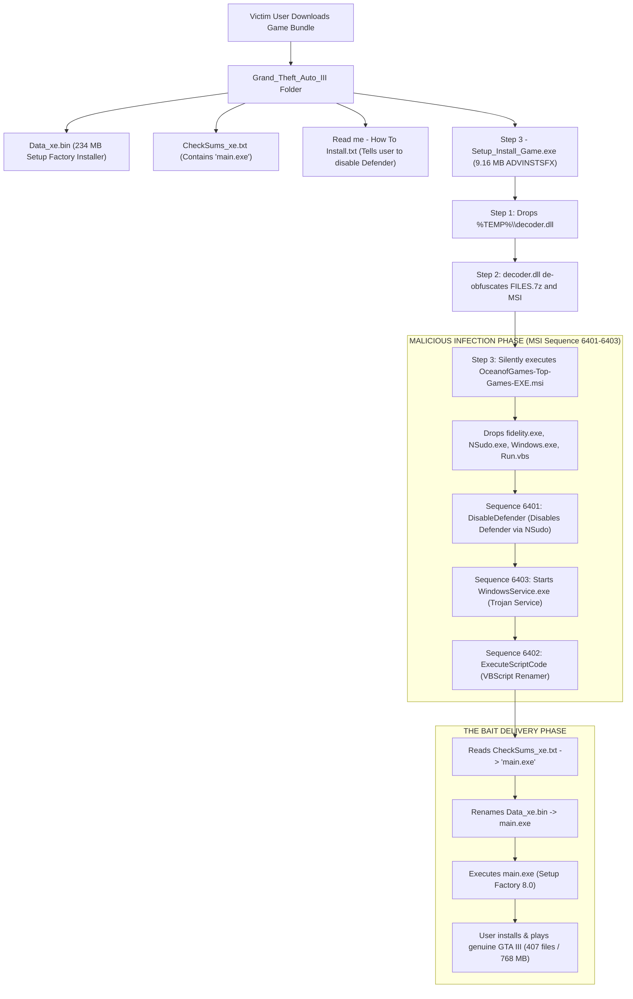

# Forensic Analysis: The Complete OceanofGames Malware Infection & Game Delivery Chain

[**[বাংলা সংস্করণ / Bengali Version]**](file:///F:/Project/skill/decoder/docs/MALWARE_CHAIN_ANALYSIS_BN.md) | [**[Main README]**](file:///F:/Project/skill/decoder/README.md)

---

## 1. Executive Summary: The "Bait & Switch" Attack Chain

Threat actors repackaging games under the **OceanofGames** banner use a sophisticated multi-stage dropper technique to infect users while still providing the real, playable game to avoid raising suspicion.



---

## 2. Where did `irsetup.exe` come from?

`irsetup.exe` was **not** dropped by `Step 3 - Setup_Install_Game.exe`. It is the internal setup engine inside **`Data_xe.bin`** (234,095,253 bytes):

* **Container Type**: **Setup Factory 8.0 Run-Time** (Indigo Rose Software).
* **Binary Signature**: PE executable followed by the overlay magic sequence:  
  `\xe0\xe0\xe1\xe1\xe2\xe2\xe3\xe3\xe4\xe4\xe5\xe5\xe6\xe6\xe7\xe7` (offset `0x14000`).
* **Embedded Engine Files**:
  1. `irsetup.exe`: The Indigo Rose setup runtime engine.
  2. `irsetup.dat`: Installer bytecode and configuration.
  3. `IRIMG1.JPG`, `IRIMG2.JPG`, `IRIMG3.JPG`: Installer splash screens.
  4. `%AppFolder%\*`: **407 clean, genuine game files** (~768 MB uncompressed) including:
     - `gta3.exe` (SHA256: `17E036FF18CDD805951FEC9107746492F582AE1EB46CA028544E37E517E8FC1F`, official GTA III v1.1 executable).
     - `Mss32.dll` (Miles Sound System).
     - All radio stations, textures, and models.

---

## 3. Ghidra & MSI Investigation: How is `Data_xe.bin` Connected?

### Why was `Data_xe.bin` NOT hardcoded in Ghidra's C++ code?
In Ghidra, `Step 3 - Setup_Install_Game.exe` is a generic **Advanced Installer SFX stub**. The attacker intentionally did **not** hardcode file paths like `Data_xe.bin` into the C++ binary so they could reuse the exact same dropper across hundreds of different repackaged games!

Instead, they embedded the trigger inside the MSI's database:
* **Table**: `CustomAction`
* **Action Name**: `ExecuteScriptCode` (Type `102` - VBScript)
* **Execution Sequence**: Sequence `6402` in `InstallExecuteSequence` (runs immediately after disabling Windows Defender):

```vbscript
strRename = "main.exe"
strdatafile = "CheckSums_xe.txt"
strFile = "Data_xe.bin"
Dim oFSO
Set oFSO = CreateObject("Scripting.FileSystemObject")
filespec = Session.Property("AI_SETUPEXEPATH")
sScriptDir = oFSO.GetParentFolderName(filespec) 

If oFSO.FileExists(oFSO.BuildPath(sScriptDir, strdatafile)) Then
    Set objFileToRead = oFSO.OpenTextFile(oFSO.BuildPath(sScriptDir, strdatafile), 1)
    strRename = objFileToRead.ReadAll()
    strRename = Replace(strRename, vbCr, "")
    strRename = Replace(strRename, vbLf, "")
    If strRename = Empty Then
        strRename = "main.exe"
    End If
End If

If oFSO.FileExists(oFSO.BuildPath(sScriptDir, strFile)) Then
    oFSO.MoveFile oFSO.BuildPath(sScriptDir, strFile), oFSO.BuildPath(sScriptDir, strRename)
End If

Dim folder
Set folder = CreateObject("WScript.Shell")
folder.CurrentDirectory = sScriptDir
folder.Run Chr(34) & oFSO.BuildPath(sScriptDir, strRename) & Chr(34), 1
```

### Forensic Takeaways:
1. The attacker disguises the genuine game installer as `Data_xe.bin` so users cannot install the game without running the dropper.
2. The attacker uses `CheckSums_xe.txt` to tell the VBScript what name to restore (e.g. `main.exe`, `setup.exe`).
3. The genuine game installer is executed **only after** all malware persistence, services, and Defender bypasses have been established.

---

## 4. Universal Static Extraction (`safe_extractor.py`)

Our defensive extractor tool (`safe_extractor.py`) now natively handles this entire ecosystem without executing any malware or installers:

```cmd
# Extract everything from the download folder:
python F:\Project\skill\decoder\src\tools\safe_extractor.py "path\to\Grand_Theft_Auto_III" -o "output_folder"

# Or extract Data_xe.bin directly to get the 100% clean game:
python F:\Project\skill\decoder\src\tools\safe_extractor.py "path\to\Data_xe.bin" -o "Clean_Game_Directory"
```
