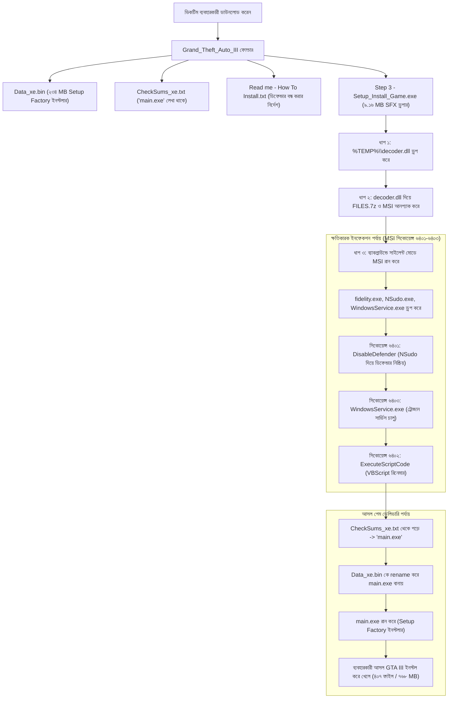

# ফরেনসিক অ্যানালাইসিস: ওশানঅবগেমস ম্যালওয়্যার ইনফেকশন ও গেম ডেলিভারি চেইন

[**[English Version / ইংরেজি সংস্করণ]**](file:///F:/Project/skill/decoder/docs/MALWARE_CHAIN_ANALYSIS.md) | [**[Main README]**](file:///F:/Project/skill/decoder/README.md)

---

## ১. সারসংক্ষেপ: "বেইট অ্যান্ড সুইচ" (Bait & Switch) অ্যাটাক চেইন

OceanofGames-এর ব্যানারে ছড়ানো ট্রোজান প্যাকেজগুলোতে আক্রমণকারীরা একটি বিশেষ বহুস্তরীয় ড্রপার কৌশল ব্যবহার করে। তাদের মূল উদ্দেশ্য থাকে ব্যবহারকারীকে কোনো সন্দেহ না জাগিয়ে কম্পিউটারে ম্যালওয়্যার ঢুকিয়ে দেওয়া এবং একই সাথে আসল গেমটিও চালু করে দেওয়া যাতে ব্যবহারকারী মনে করে সবকিছু স্বাভাবিকভাবে কাজ করছে।



---

## ২. `irsetup.exe` কোথা থেকে আসলো এবং এটি কীভাবে পাওয়া গেল?

`irsetup.exe` ফাইলটি কিন্তু `Step 3 - Setup_Install_Game.exe` ড্রপ করেনি। এটি আসলে **`Data_xe.bin`** (২৩৪,০৯৫,২৫৩ বাইট) ফাইলের ভেতরে সংরক্ষিত রয়েছে:

* **কন্টেইনারের ধরন**: এটি মূলত **Setup Factory 8.0 Run-Time** (Indigo Rose Software-এর তৈরি একটি ইনস্টলার)।
* **বাইনারি সিগনেচার**: PE এক্সিকিউটেবল হেডার এবং অফসেট `0x14000`-এ Setup Factory ওভারলে সিগনেচার:  
  `\xe0\xe0\xe1\xe1\xe2\xe2\xe3\xe3\xe4\xe4\xe5\xe5\xe6\xe6\xe7\xe7`।
* **ভেতরের ফাইলসমূহ**:
  1. `irsetup.exe`: Indigo Rose Setup Factory-এর নিজস্ব রান-টাইম ইঞ্জিন।
  2. `irsetup.dat`: ইনস্টলারের ইন্টারনাল বাইটকোড ও কনফিগারেশন।
  3. `IRIMG1.JPG`, `IRIMG2.JPG`, `IRIMG3.JPG`: ইনস্টলারের ব্যাকগ্রাউন্ড ছবি।
  4. `%AppFolder%\*`: **৪০৭টি পরিষ্কার এবং আসল গেম ফাইল** (~৭৬৮ মেগাবাইট আনকম্প্রেসড) যার ভেতর রয়েছে:
     - `gta3.exe` (SHA256: `17E036FF18CDD805951FEC9107746492F582AE1EB46CA028544E37E517E8FC1F`, যা অফিসিয়াল GTA III v1.1 গেম এক্সিকিউটেবল)।
     - `Mss32.dll` (Miles Sound System অডিও ইঞ্জিন)।
     - সমস্ত অডিও, রেডিও স্টেশন, মডেল এবং টেক্সচার ফাইল।

---

## ৩. Ghidra এবং MSI বিশ্লেষণ: কেন Ghidra-র C++ কোডে `Data_xe.bin` সরাসরি লেখা নেই?

Ghidra-তে `Step 3 - Setup_Install_Game.exe` পরীক্ষা করলে দেখা যায় এটি একটি জেনেরিক **Advanced Installer SFX Stub**। আক্রমণকারীরা ইচ্ছাকৃতভাবে `Data_xe.bin` বা `main.exe` নামগুলো C++ কোডের ভেতর হার্ডকোড করেনি, যাতে তারা একই ড্রপার দিয়ে শত শত ভিন্ন ভিন্ন গেম রিপ্যাক করতে পারে!

পরিবর্তে তারা ড্রপ করা MSI প্যাকেজটির ভেতর একটি ডায়নামিক VBScript যুক্ত করে দেয়:
* **টেবিল**: `CustomAction`
* **অ্যাকশন নাম**: `ExecuteScriptCode` (টাইপ: `102` - VBScript)
* **এক্সিকিউশন সিকোয়েন্স**: সিকোয়েন্স `6402` (ডিফেন্ডার বন্ধ ও সার্ভিস চালুর ঠিক পরপরই রান হয়):

```vbscript
strRename = "main.exe"
strdatafile = "CheckSums_xe.txt"
strFile = "Data_xe.bin"
Dim oFSO
Set oFSO = CreateObject("Scripting.FileSystemObject")
filespec = Session.Property("AI_SETUPEXEPATH")
sScriptDir = oFSO.GetParentFolderName(filespec) 

If oFSO.FileExists(oFSO.BuildPath(sScriptDir, strdatafile)) Then
    Set objFileToRead = oFSO.OpenTextFile(oFSO.BuildPath(sScriptDir, strdatafile), 1)
    strRename = objFileToRead.ReadAll()
    strRename = Replace(strRename, vbCr, "")
    strRename = Replace(strRename, vbLf, "")
    If strRename = Empty Then
        strRename = "main.exe"
    End If
End If

If oFSO.FileExists(oFSO.BuildPath(sScriptDir, strFile)) Then
    oFSO.MoveFile oFSO.BuildPath(sScriptDir, strFile), oFSO.BuildPath(sScriptDir, strRename)
End If

Dim folder
Set folder = CreateObject("WScript.Shell")
folder.CurrentDirectory = sScriptDir
folder.Run Chr(34) & oFSO.BuildPath(sScriptDir, strRename) & Chr(34), 1
```

### আক্রমণের মূল ফরেনসিক পয়েন্টসমূহ:
১. আক্রমণকারী আসল গেম ইনস্টলারকে `Data_xe.bin` নামে ছদ্মবেশে রাখে যাতে ব্যবহারকারী ড্রপার চালু না করে সরাসরি গেম ইনস্টল করতে না পারে।
২. `CheckSums_xe.txt` ফাইলের ভেতর আসল ইনস্টলারের নাম (যেমন `main.exe`) লিখে রাখা হয়, যাতে VBScript স্বয়ংক্রিয়ভাবে তা পড়তে পারে।
৩. পুরো সিস্টেমে ম্যালওয়্যার সার্ভিস, রেজিস্ট্রি কি এবং পারসিস্টেন্স সেটআপ হওয়ার পরেই কেবল আসল গেমের সেটআপ চালু করা হয়।

---

## ৪. আমাদের অ্যাপ্লিকেশনে নতুন ফিচার (`safe_extractor.py`)

আমাদের [`safe_extractor.py`](file:///F:/Project/skill/decoder/src/tools/safe_extractor.py) টুলে এখন স্বয়ংক্রিয়ভাবে উভয় ধরনের কন্টেইনার শনাক্ত এবং আনপ্যাক করার ফিচার যুক্ত করা হয়েছে:

```cmd
# ডাউনলোড ফোল্ডার থেকে সম্পূর্ণ পরিষ্কার গেম এবং ম্যালওয়্যার রিপোর্ট বের করতে:
python F:\Project\skill\decoder\src\tools\safe_extractor.py "ডাউনলোড_ফোল্ডারের_পাথ" -o "আউটপুট_ফোল্ডার"

# অথবা সরাসরি Data_xe.bin থেকে আসল গেমটি সম্পূর্ণ আনপ্যাক করতে:
python F:\Project\skill\decoder\src\tools\safe_extractor.py "Data_xe.bin" -o "Clean_Game_Directory"
```
কোনো ইনস্টলার বা ক্ষতিকারক কোড রান না করেই সরাসরি আসল গেম খেলা সম্ভব!
